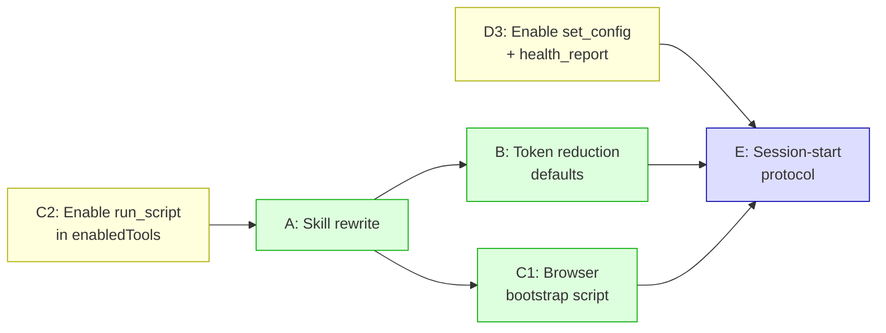

# Speed & Token Efficiency Plan — Closing the Gap with Codex Computer Use

> **Goal.** Make the Antigravity CUA plugin 3–5× faster and dramatically more token-efficient, matching the observed behaviour of ChatGPT Codex's built-in computer-use, which completes the same GUI tasks in a fraction of the time and tool calls.

## The gap today (observed)

| Metric | Codex built-in | Antigravity + CUA plugin |
| --- | --- | --- |
| Typical browser form task | ~15 s, 3–5 tool calls | ~75 s+, 12–20+ tool calls |
| State reads per action | 0–1 (often embedded in the action) | 2–3 (full read, act, full re-read) |
| Screenshot tokens per read | Small or none (text-first) | Full PNG every time (~2–4k tokens) |
| Verification overhead | Inline in action response | Separate `verify_state` + another `get_window_state` |
| Round-trips to the model | Minimal — batched scripts | One per tool call, model re-plans every time |
| Browser routing | Direct CDP/typed, no discovery loop | Discovery → prepare → bind → snapshot → navigate → act → re-snapshot |

## Root causes

1. **Over-reading.** Every action is preceded and followed by a full `get_window_state` or `get_browser_state` read. The model sees the whole accessibility tree and a full-res screenshot even when it only needs one button.
2. **No batching by default.** The skill instructions say to use `run_steps`, but the model almost always falls back to one-tool-at-a-time because the skill text is long and the batching examples are buried. The model doesn't reach `run_script` at all for multi-step flows.
3. **Redundant verification.** After acting, the model calls `verify_state` and then *also* calls `get_window_state` to "confirm" — double-reading. `run_steps` already supports inline `expect` checks, but they're unused.
4. **Expensive browser bootstrapping.** Every browser task pays: `browser_prepare` → `get_browser_state` (bind) → `get_browser_state` (snapshot) → `browser_navigate` → `get_browser_state` (re-snapshot). That's 5 calls before a single click. Codex does this in ≤2.
5. **Screenshot bloat.** Screenshots are always full PNG at native resolution. The model processes thousands of image tokens per read when a text-only tree diff or a small JPEG thumbnail would suffice.
6. **Skill prompt is too long and passive.** The 22-line SKILL.md reads like a reference manual, not a playbook. The model treats it as FYI rather than as a strict protocol, and falls back to the safest (slowest) pattern.

---

## The plan

### Phase A — Skill rewrite for speed-first defaults

**What changes:** Rewrite `plugin/skills/computer-use/SKILL.md` to enforce fast patterns.

> [!IMPORTANT]
> This is the highest-leverage change. The model's behaviour is shaped by the skill prompt more than by any code change.

#### A1. "Batch first" mandate

Replace the current passive mention of `run_steps` with a hard rule at the top of the skill:

```
ALWAYS use run_steps for actions. Never call click, type_text, set_value,
press_key, or hotkey as standalone tools. A single action is run_steps
with one step. Include observe:{} to get the result in the same call.
```

This alone eliminates the read → act → read cycle (3 calls → 1).

#### A2. "Scripts for flows" mandate

Add an explicit rule:

```
For any sequence of 3+ actions with a known target, or any loop/branch,
use run_script. One call replaces the entire multi-step flow. Return only
the final value — do not log intermediate state.
```

Provide 2–3 compact recipe scripts for common patterns:
- **Browser form fill & submit** — navigate, fill fields, click submit, read result.
- **Native text edit** — find window, place caret, type, verify.
- **Browser-to-native transfer** — read token from page, paste into native app.

#### A3. Kill redundant verification

Replace the "verify at checkpoints" paragraph with:

```
Verification: use run_steps expect checks. ONE expect at the end of a
batch is enough. Do NOT call verify_state separately after a run_steps
batch that already has expect. Do NOT call get_window_state after a
run_steps batch that already has observe:{}.
```

#### A4. Shrink the prompt

Target ≤ 12 lines. Move reference material (browser binding protocol, stale-token recovery, mixed-task handoff) into a `get_guide` topic or an appendix the model can pull on demand, not into the always-loaded skill prompt.

---

### Phase B — Reduce token cost per read

#### B1. Default to tree-only reads (no screenshot)

Add to the skill:

```
Default: include_screenshot:false on get_window_state. Use screenshots
only when the tree is empty, truncated, or you need pixel coordinates.
Use screenshot_format:"jpeg" with max_dimension:800 when you do.
```

This drops ~2,000–4,000 image tokens per read.

#### B2. Always use diff reads after the first

Add to the skill:

```
After the first read of a window, ALWAYS use since:"latest" on subsequent
get_window_state calls. Never request a full re-read unless since_status
reports a fallback.
```

Diff reads return only changed rows — often just 2–5 lines instead of 250.

#### B3. Use `query` for targeted reads

```
When you need one element (a button, a text field, a status label), use
query:"Submit" instead of reading the full tree. This returns the matching
rows plus ancestors only.
```

#### B4. Browser: use `semantic_v2` with `query`

```
For browser reads, use snapshot_format:"semantic_v2" with query when you
need one element or region. Use scope_ref for subtree reads. Do not
snapshot the entire page when you need one value.
```

---

### Phase C — Faster browser bootstrapping

#### C1. One-call browser setup recipe

Write a `run_script` recipe that collapses the 5-call browser bootstrap into one:

```javascript
// run_script: one call replaces browser_prepare + bind + navigate + snapshot + act
const prep = await cua.call("browser_prepare", {
  allow_launch: true,
  profile: { mode: "isolated_new" }
});
const pid = prep.prepared_pid;
// find the window
const wins = await cua.call("list_windows", { pid });
const wid = wins[0].window_id;
// bind
const bind = await cua.call("get_browser_state", {
  pid, window_id: wid
});
// navigate
await cua.call("browser_navigate", {
  target_id: bind.target_id,
  tab_id: bind.tabs[0].tab_id,
  url: TARGET_URL
});
// snapshot and act — all in one script
const snap = await cua.call("get_browser_state", {
  target_id: bind.target_id,
  tab_id: bind.tabs[0].tab_id,
  snapshot_format: "semantic_v2"
});
// ... fill form, click submit, read result
return result;
```

The model doesn't have to re-plan between each bootstrap step.

#### C2. Add `run_script` to `enabledTools`

Currently `run_script` is **not in the `enabledTools` list** in `mcp_config.json`. The model can't use it. Add it:

```json
"enabledTools": [
  ...existing...,
  "run_script"
]
```

This is a prerequisite for Phases A2 and C1.

---

### Phase D — Configuration tuning

#### D1. Enable `fast_path`

The `set_config` tool has an experimental `fast_path` option. Set it to `"on"` at session start:

```
set_config({ fast_path: "on" })
```

This enables: cached target checks at act time, target-changed guards, delta in action results, and tree-only re-reads. Exactly the kind of "don't re-read what hasn't changed" optimization Codex uses natively.

#### D2. Lower `max_image_dimension` globally

Set `max_image_dimension: 800` via `set_config` as a session default. When the model does request a screenshot, it's 800px on its longest edge instead of native resolution. This halves or quarters image token cost.

#### D3. Add `set_config` and `health_report` to `enabledTools`

These are currently gated out. The skill should be able to set `fast_path` and check driver health without requiring the user to do it manually.

```json
"enabledTools": [
  ...existing...,
  "run_script",
  "set_config",
  "health_report"
]
```

---

### Phase E — Session-start protocol in the skill

Add a compact startup block to the skill that runs once at the beginning of every computer-use task:

```
SESSION START (do this once, silently):
1. set_config({ fast_path: "on", max_image_dimension: 800 })
2. start_session({ session: "<task-label>" })
3. For browser: run_script the full bootstrap (Phase C1).
4. For native: list_windows + one narrow get_window_state with query.
Then proceed to the task using run_steps/run_script exclusively.
```

This replaces the current pattern where the model spends 4–6 calls on discovery and setup before doing anything useful.

---

## Expected impact

| Metric | Before | After (projected) |
| --- | --- | --- |
| Tool calls for browser form task | 12–20+ | 3–5 |
| Wall time for browser form task | 75 s+ | 15–25 s |
| Tokens per state read | 2,000–5,000 (tree + screenshot) | 100–500 (diff or query, no image) |
| Model re-planning rounds | 8–15 | 2–4 |
| Browser bootstrap calls | 5 | 1 (`run_script`) |
| Verification overhead | 2 extra calls | 0 (inline `expect`) |

---

## Implementation order & risk



| Phase | Risk | Mitigation |
| --- | --- | --- |
| **C2, D3** (enable tools) | Low — additive config change | Validate with `agy plugin validate --strict` |
| **A** (skill rewrite) | Medium — model may ignore strict rules if prompt is too terse | Test with live runs; iterate on wording |
| **B** (token defaults) | Low — all options already exist in the driver | Fallback to full reads when tree is empty |
| **C1** (browser script) | Medium — `run_script` sandbox limits (no network, no FS) | Already supported: `cua.call()` can call all browser tools |
| **D1** (fast_path) | Medium — marked experimental | Shadow mode first, then guard, then on |
| **E** (session protocol) | Low — combines A–D into a startup sequence | Test as a unit after all parts work |

---

## What NOT to change

- **No new code in the plugin.** All optimizations use existing Cua Driver features (`run_steps` expect, `run_script`, `since:"latest"`, `query`, `fast_path`, `max_image_dimension`, `screenshot_format:"jpeg"`). The gap is in the skill guidance, not in the driver.
- **No custom adapter or middleware.** The ROADMAP Phase 1 decision explicitly deferred adapters until a measured gap calls for one. This plan uses the stock MCP path.
- **No changes to Cua Driver source.** All changes are in `plugin/skills/computer-use/SKILL.md`, `plugin/mcp_config.json`, and the `docs/` directory.

---

## Validation criteria (per CONTRIBUTING.md)

1. **Same-task comparison.** Run the VALIDATION.md browser form task (scenario 3) before and after. Report tool calls, elapsed time, token count, and verified result.
2. **Codex reference.** Run the same task in Codex built-in computer-use. Report the gap.
3. **Regression check.** Run native scenarios 1, 2, and 4 to confirm no breakage.
4. **Token audit.** Compare total input/output tokens for the before and after Antigravity runs on the same model.
